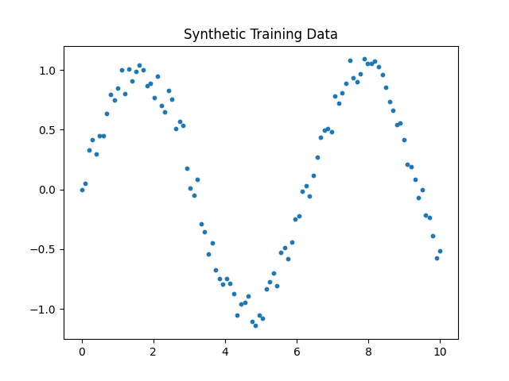
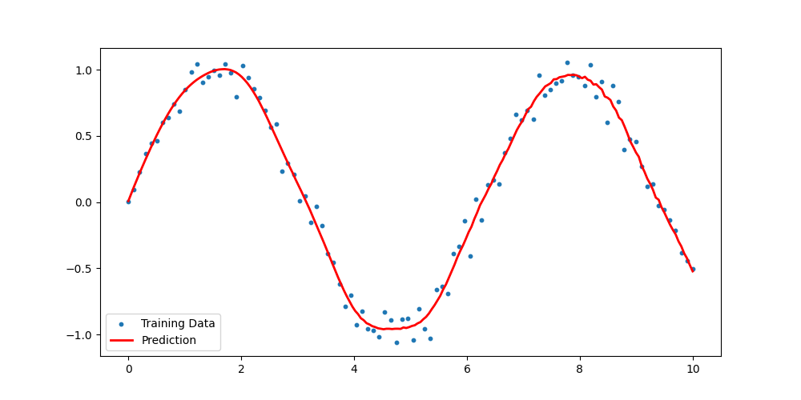
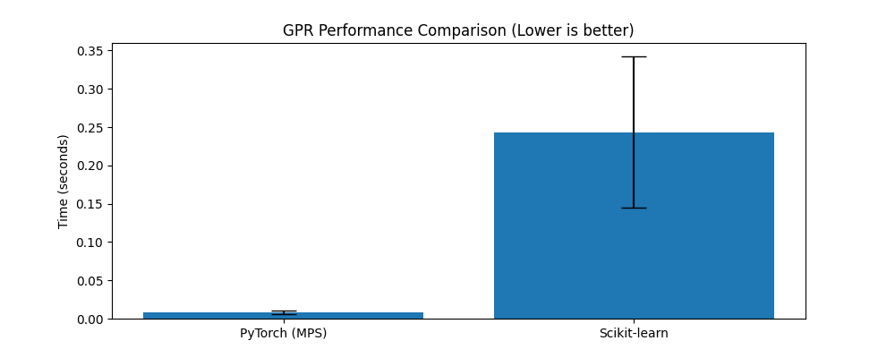

# Gaussian Process Regression with PyTorch

**Machine Learning project | PyTorch implementation**

## Overview

This project implements Gaussian Process Regression (GPR) using PyTorch, focusing on kernel computation, Gaussian process inference, and uncertainty-aware regression.

Unlike using a high-level GPR library, the project explores the core components behind Gaussian Process models, including RBF kernel computation and Cholesky-based matrix solving.

## Pipeline

```text
Input Data
    |
    v
RBF Kernel Computation
    |
    v
Kernel Matrix Construction
    |
    v
Cholesky Decomposition
    |
    v
Posterior Prediction
    |
    v
Visualization
```

## Features

- Implemented Gaussian Process Regression with PyTorch
- Built an RBF kernel from scratch
- Used Cholesky decomposition for kernel matrix inference
- Explored Apple Silicon MPS acceleration
- Visualized regression predictions on synthetic data

## Tech Stack

- Python
- PyTorch
- NumPy
- Matplotlib
- Jupyter Notebook

## Project Structure

```text
.
├── gpr.py                 # Main GPR implementation
├── gpr_demo.ipynb         # Interactive demonstration
├── results/
│   ├── data.png
│   ├── gpr_result.png
│   └── performance.png
├── requirements.txt
└── README.md
```

## Results Visualization

### Input Data



### GPR Prediction



### Performance



## Running

```bash
python3 -m venv .venv
source .venv/bin/activate
pip install -r requirements.txt
python gpr.py
```

## Notes

This project uses synthetic data to demonstrate Gaussian Process Regression concepts. The implementation is intended for algorithm exploration and learning rather than production deployment.
